<picture>
  <source media="(prefers-color-scheme: dark)" srcset="docs/assets/hero-dark.svg">
  
</picture>

[](https://github.com/Stephen-Pu/agent-state-storage/actions)
[](LICENSE)
[](#what-works-today)
[](#roadmap)

**An agent session is more than a chat log.** It is the model's KV cache, the sandbox it works in, the memory it carries and the steps it has already taken. Agent teams need to **fork** that session for sub-agents and tree search, **resume** it after a crash without replaying tool calls, and **erase** a user from it when the law says so.

Every major platform now does a piece of this, inside its own walls. **AgentStateStorage is the open, self-hosted version**: one session tree for every kind of agent state, with compliance built in, on your infrastructure, under any inference engine and any cloud.

> **Status, honestly.** The KV state layer underneath (identity addressing, tiering, the keep-or-recompute brain, hard multi-tenancy) is **built and tested**. The first piece of the session layer is **usable today on one node**: a gRPC session API, a Python SDK, and drop-in persistence for the **OpenAI Agents SDK** and **LangGraph** ([try it](#try-it)). The session tree and erase · hold · audit are **what we are building now**. The [capability matrix](#capability-matrix) is the contract.

---

## Why a session layer

| You are building… | You need to… | Today |
|---|---|---|
| Coding agents, deep research, multi-agent systems | **fork** a session into parallel sub-agents or search branches, cheaply | Each platform forks only its own piece: the engine its KV, the sandbox vendor its filesystem, the memory store its records |
| Long-running agents | **resume** after a crash or deploy, without re-running tool calls that already sent the email or charged the card | Durable-execution engines and agent platforms each keep their own snapshot format; none travels between them |
| Anything with real users in the EU, healthcare or finance | **erase** a user and everything derived from them (summaries, embeddings, cached KV), while **keeping** the audit log the law requires | Erasure stops at the store you call; derived state is left behind. The EU AI Act's logging duty (Art. 12) applies from 2026-08-02, alongside GDPR erasure |

<picture>
  <source media="(prefers-color-scheme: dark)" srcset="docs/assets/session-tree-dark.svg">
  
</picture>

### The four verbs

> **Planned API (M2), not implemented yet.** Shown so you can tell us if it fits your agent. What runs today is in [Try it](#try-it).

```python
from agent_state_storage import Client            # gRPC client, Python first, TypeScript next

ss = Client("grpc://state.internal:7000", tenant="acme")

s2 = ss.snapshot(session="sess-123")              # KV prefix + workspace + memory, one lineage id
kids = [ss.fork(s2) for _ in range(3)]            # O(1), copy-on-write
ss.resume(s2)                                     # after a crash: no tool call replayed
receipt = ss.erase(subject="user-42")             # cascades along lineage; legal holds respected
```

First integrations: **OpenAI Agents SDK** (sessions and sandbox workspace snapshots) and **LangGraph** (checkpointer and store), both shipped in M1 (below), then an **MCP server** that hands out session handles, as the MCP 2026-07-28 spec expects for cross-call state.

## Try it

Works today, single node. One node serves every agent; state survives a restart.

```bash
kvstore-node --grpc-port 7000 --state-dir ./agent-state      # build: see BUILD.md
pip install -e "src/sdk/python[openai-agents,langgraph]"
python examples/m1_quickstart.py                            # no API key needed; run it twice
```

```python
from agents import Runner
from agent_state_storage import AsyncClient, Client
from agent_state_storage.openai_agents import AgentStateSession
from agent_state_storage.langgraph import AgentStateSaver, AgentStateStore

# OpenAI Agents SDK (inside an async function): history that survives restarts and can be forked
session = AgentStateSession("conv-1", AsyncClient("localhost:7000", tenant="acme"))
result = await Runner.run(agent, "hi", session=session)
branch = await session.fork("conv-1-try-b")

# LangGraph: checkpoints (time travel, copy_thread) and long-term memory
client = Client("localhost:7000", tenant="acme")
graph = builder.compile(checkpointer=AgentStateSaver(client), store=AgentStateStore(client))
```

- **OpenAI Agents SDK**: `AgentStateSession` implements the SDK's `Session` protocol; `AgentStateSnapshotClient` stores sandbox workspace snapshots for a `RemoteSnapshotSpec`.
- **LangGraph**: `AgentStateSaver` passes LangGraph's checkpointer conformance suite (put, writes, get, list, delete, copy thread); `AgentStateStore` is a `BaseStore` with filters and namespaces (no vector search yet).
- **gRPC API** (`agentstate.v1`, [proto](src/core/proto/agentstate.proto)): per-session item logs, an ordered record space with atomic batches, and streamed blobs, all scoped to a tenant. With mTLS the tenant comes from the client certificate.
- **Limits**: 4 MiB per item or record value, 64 MiB per request, 4 GiB per blob; reads page automatically. One node process per `--state-dir` (enforced with a lock).

> ⚠️ Without `--tls-*` flags the node listens in plaintext and trusts the tenant each request names; it prints a warning at startup. Keep that mode on one trusted machine, and use mTLS anywhere else ([SECURITY.md](SECURITY.md)).

---

## Where it sits

<picture>
  <source media="(prefers-color-scheme: dark)" srcset="docs/assets/architecture-dark.svg">
  
</picture>

One node process serves two planes, split by one question: *can it be recomputed?*

- **Session state (irreplaceable)**: conversation items, framework checkpoints and stores, and workspace blobs, served by `agentstate.v1`. Governed by durability: every write is fsynced before it is acknowledged. Today that is one replica on the node's local disk (`--state-dir`); replication and an object-storage copy are on the roadmap.
- **KV cache (recomputable)**: attention KV prefixes, served by `NodeData` to inference engines. Governed by cost: content-identity addressing, a keep-or-recompute brain, and DRAM → NVMe → object storage tiering (S3 API, including an Alluxio multi-cloud UFS), with per-tenant quotas and priorities. Losing an entry costs a recompute, not data.
- **The session tree (M2)** spans both. A snapshot references the items, records, blobs and KV prefix together, and lineage lets an erase cascade from a user to everything derived from them while a legal hold keeps the audit log.

Around the node sit a control plane (etcd membership, HRW routing, the Kubernetes operator and `KVCacheTenant` CRD, quotas) and peer nodes that forward lookups; the cross-node data path is M4. On the session API the tenant comes from the mTLS client certificate; on the KV API that binding exists but is not on yet (see [SECURITY.md](SECURITY.md)).

---

## Capability matrix

As of 2026-10. ✅ built and tested · 🟡 partial · 🚧 next (M1–M2) · ⏳ later.

| Capability | Status | Notes |
|---|:---:|---|
| KV state: identity addressing, DRAM/NVMe/object tiers, keep-or-recompute brain, per-tenant quotas | ✅ | Single node |
| KV state across nodes (zero-copy data path, RDMA backends) | ⏳ | Interfaces in place; in-process today |
| Durable ingest for irreplaceable state (WAL, crash recovery) | 🟡 | Single node; survives a process restart, not a node loss |
| Session tree: snapshot, fork, resume, diff | 🚧 | M2. Today: resume after a restart, and fork by copy (conversations, LangGraph threads) |
| Erase · hold · audit | 🚧 | M2 |
| Python SDK + gRPC API | ✅ | Single node; `agentstate.v1` items, records, blobs |
| OpenAI Agents SDK, LangGraph integrations | ✅ | Session + sandbox snapshots; checkpointer + store (no vector search) |
| MCP server | ⏳ | M3 |
| TypeScript SDK | ⏳ | After M1 |
| Agent memory (versioned, immutable; consolidation writes a new version) | 🚧 | M2 |
| Execution state, embeddings, tool-result caching | ⏳ | |

## Works with your inference engine

| Engine | How it connects | Status |
|---|---|---|
| **vLLM** | Native KV connector (`KVConnectorBase_V1`); a tier behind vLLM's built-in offloading (`SecondaryTierManager`) is next | ✅ connector · 🚧 offload tier |
| **SGLang** | HiCache storage backend | 🚧 |
| **NVIDIA Dynamo** | Through the engine's native offloading (Dynamo v1.5 deprecated KVBM in favour of it) | 🚧 |
| **TensorRT-LLM** | Through LMCache | ⏳ |
| **llm-d · AIBrix · Ray Serve LLM** | Through the vLLM path | ⏳ to verify |
| **LMDeploy** | No external KV storage interface yet | ⏸ |
| **Hugging Face TGI** | Archived upstream (2026-03); migrate to vLLM or SGLang | ❌ |
| **DeepSpeed-MII** | No external KV storage interface | ❌ |
| **Any language** | C ABI (`lookup / reserve / publish / fetch / seal / release`) | ✅ |

The adapters under `src/adapters/` other than vLLM are interface shims, not engine integrations yet.

---

## What works today

- **L1 engine**: BLAKE3 identity hashing, lock-free ART reads, persistent ART with WAL, cross-process pull, per-tenant priority scheduler.
- **L2 coordination**: HRW + Bloom routing, etcd membership.
- **L3 service**: 3-D quotas, three priority classes with anti-starvation, mTLS with rotation, optional fail-closed regulated mode.
- **L4 integration**: vLLM connector, gRPC service, OTLP traces, Prometheus metrics.
- **Kubernetes**: Helm chart, operator, `KVCacheTenant` CRD, kind end-to-end test.
- **B-plane, first step**: durable single-node ingest (`StatePut` / `StateGet` over a WAL, with DRAM degradation and replay).
- **Session API (M1)**: `agentstate.v1` gRPC service in `kvstore-node` (`--state-dir` for durability), Python SDK, OpenAI Agents SDK and LangGraph integrations.
- **Tests**: 580+ C++ tests (ctest) plus Go and Python suites, including LangGraph's checkpointer conformance suite; CI runs on Ubuntu 22.04, and on 24.04 for the gRPC node and the Python SDK.

Security posture and known gaps: [SECURITY.md](SECURITY.md).

### What the KV layer is worth (projection)

One 100K-token RAG query with a 90K shared prefix, Llama-3.1-70B on 8× H100, 95% steady-state hit rate, $4/h per H100:

| | Cold start | With the KV layer |
|---|---:|---:|
| End-to-end latency | 525 s | 30 s |
| Cost per query | $1.17 | $0.07 |

<sub>A traced **projection** from the design documents, not a benchmark. A reproducible benchmark on real multi-turn agent traces (TTFT and cost per turn) is on the roadmap and will replace it.</sub>

---

## Roadmap

| Milestone | Scope |
|---|---|
| **M0** ✅ | License and governance, CI green, honest matrix |
| **M1** ✅ | gRPC API + Python SDK; OpenAI Agents SDK and LangGraph integrations, single node |
| **M2** | Session tree + erase · hold · audit, with a demo: fork a coding agent eight ways, kill it, resume it, erase a user and get a receipt |
| **M3** | MCP server; reproducible agent-trace benchmark |
| **M4** | vLLM / SGLang offload tiers; cross-node data path; KV prefix in the session tree |

## Landscape (as of 2026-10)

| | Focus | What this project adds |
|---|---|---|
| Inference engines: vLLM tiered offloading ([2026-09-10](https://vllm.ai/blog/2026-09-10-tiered-kv-offloading)), SGLang HiCache, NVIDIA Dynamo ([KVBM deprecated in v1.5, 2026-09-18](https://docs.nvidia.com/dynamo/reference/releases/deprecations)) | KV offload inside one engine | A shared, multi-tenant tier behind them, and KV as one part of a session |
| Storage KV tiers: NVIDIA CMX partners ([2026-03](https://www.blocksandfiles.com/ai-ml/2026/03/30/nvidia-and-its-partners-kv-cache-extenders/5209284)) | Fast KV capacity close to the GPU | Software-only, any hardware; the durable tier underneath a cache tier |
| Agent platforms: OpenAI Agents SDK sandbox snapshots ([2026-04](https://openai.github.io/openai-agents-js/guides/sandbox-agents)), Cloudflare Project Think session trees ([2026-04](https://blog.cloudflare.com/project-think/)), Temporal sandboxes ([2026-04](https://temporal.io/blog/introducing-temporal-and-agentic-sandboxes-openai-agents-sdk)) | Snapshot / fork / resume inside one platform | One session format across engines, frameworks and clouds, self-hosted |
| Agent memory: Letta context repositories ([2026-03](https://www.letta.com/blog/our-next-phase)), Anthropic Dreams ([2026-05](https://platform.claude.com/docs/en/managed-agents/dreams)), Mem0, Zep | Memory records and consolidation | Memory in the same lineage as KV and workspace, so erase cascades across all of them |

---

## Build

```bash
git clone https://github.com/Stephen-Pu/agent-state-storage.git && cd agent-state-storage
python3 -m venv .venv && source .venv/bin/activate && pip install cffi pytest
make all      # C++ (ctest), Go and Python suites
```

Details: [BUILD.md](BUILD.md). Design documents (HLD/LLD) are available to active contributors on request.

## Contributing

Issues and pull requests are welcome; please read [CONTRIBUTING.md](CONTRIBUTING.md). Contributors sign a [CLA](CLA.md) once.

## Acknowledgments

**vLLM** · **SGLang** · **Mooncake** · **LMCache** · **NVIDIA Dynamo / NIXL** · **3FS** · **DAOS** · **Alluxio** · **BLAKE3** · **etcd** · **gRPC**.

## License

[Apache-2.0](LICENSE). See [NOTICE](NOTICE).

<sub>Built by [Stephen Pu](https://github.com/Stephen-Pu).</sub>
